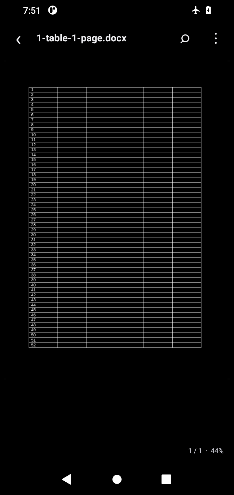

# FolioDock

An offline Android document reader with AMOLED-black chrome, a compact 56 dp toolbar, and a real LibreOffice layout engine. Office pages are no longer reconstructed from extracted text.

 

## Download the APK

Open [Releases](https://github.com/virgil48YT/foliodock/releases/latest) and download **FolioDock-arm64-v8a.apk** for a modern 64-bit ARM Android phone. **FolioDock-x86_64.apk** is for compatible Intel devices or Android emulators. The release assets are raw `.apk` files, not ZIP archives; `SHA256SUMS.txt` accompanies each build.

Android 8.0 or later is required. There is no 32-bit ARM build. Expect a substantially larger download than version 1 because the native layout engine and fonts are bundled for offline use.

The old version was signed with an Android debug key. This version uses a separate, persistent release key. **Uninstall the old debug build before installing version 2** if Android reports a signature conflict. Uninstalling deletes FolioDock's private imported copies; keep or share any needed copies first. Your original source documents are not changed by FolioDock.

Release signing establishes a stable signing identity, not a Google security endorsement. Play Protect may still scan, warn about, or block sideloaded apps; do not disable protection merely because an APK is signed. See [Google's Play Protect documentation](https://support.google.com/googleplay/answer/2812853?hl=en).

## Reading experience

- **AMOLED UI:** Pure `#000000` app background, dialogs, status/navigation bars, and toolbar. No large hero panel or permanent search, warning, font, or navigation bars above the document.
- **Full Office layout:** LibreOffice 26.2.6.3 renders page geometry, paragraph styles, tables, images, drawings, and supported charts instead of flattening content into text.
- **Navigation:** Pinch to zoom, drag to pan, and double-tap to zoom. The overflow menu contains page/slide/sheet selection, previous/next, fit width, zoom, sharing, and external-app opening.
- **Page colors:** Original document colors are preserved by default. “Night page colors” optionally inverts the displayed PDF/Office bitmap without modifying the source file.
- **Text search:** TXT, Markdown, CSV, and TSV retain searchable text/table previews. Supported modern Office formats have an optional text preview for search; choosing Find from a layout preview switches to it. Return with “Full layout.”
- **Local files:** Android's system picker imports a bounded copy into app-private storage. Recent files, filtering, sharing, and deleting the local copy remain available.

## Supported formats

| Family | Reader |
| --- | --- |
| PDF | Native Android `PdfRenderer`, original page layout, lazy page rendering |
| Word / Writer | DOC, DOCX, DOCM, DOT, DOTX, DOTM, ODT, OTT, FODT, RTF via LibreOffice |
| Excel / Calc | XLS, XLSX, XLSM, XLT, XLTX, XLTM, XLSB, ODS, OTS, FODS via LibreOffice |
| PowerPoint / Impress | PPT, PPTX, PPTM, PPS, PPSX, PPSM, POT, POTX, POTM, ODP, OTP, FODP via LibreOffice |
| Draw | ODG, OTG, FODG via LibreOffice |
| Text / data | TXT, MD, CSV, TSV through the bounded text/table reader |
| Other / damaged / encrypted | Error handling and external-app fallback; not a universal importer |

This is a full-layout engine, **not a guarantee of pixel-identical Microsoft Office output**. Font substitution, advanced charts, embedded objects, unusual formats, or unsupported features can differ. Macros and scripts are disabled; VBA is not executed. Encrypted files currently require another app. Office mode is read-only and does not implement editing, annotations, text selection, or saving changes. PDF search and pinch zoom are not implemented.

## Privacy and renderer safeguards

There is no Internet permission, analytics SDK, advertising SDK, cloud upload, or background synchronization. Files are not sent to a conversion server. Native LibreOffice initialization, document handles, part changes, and tile painting are serialized on one process-lifetime worker. Rendering uses viewport tiles with a bounded bitmap cache, not a bitmap of an entire workbook. Native parser bugs can still crash the process; no document parser is a blanket guarantee that an arbitrary hostile file is safe.

The private LibreOffice profile explicitly disables macro execution and sets macro security to Very High before initialization. Display gestures do not send editing, macro, mouse, keyboard, or save commands to the document. Android backup/transfer exclusions cover the private document storage and engine profile.

Imports are limited to 80 MB. The fallback text parser retains bounded ZIP/XML expansion and output limits, UTF-8 XML restrictions, DTD/entity rejection, and spreadsheet pagination. Those text-parser limits are not represented as sandbox guarantees for the separate native engine.

## Build locally

Requirements: JDK 17, Android SDK platform 35, Build Tools 35.0.0, `curl`, `unzip`, and `sha256sum`. The Gradle 8.9 wrapper is included and verifies its distribution checksum.

```sh
export ANDROID_HOME=/path/to/android-sdk
./scripts/prepare-office-engine.sh
./gradlew testDebugUnitTest lintDebug assembleDebug
```

The preparation script downloads two original F-Droid LibreOffice APKs, verifies pinned SHA-256 hashes, and extracts only the required assets and native libraries into ignored dependency directories. It never copies the upstream application's DEX code. Build outputs contain separate ARM64 and x86_64 APKs.

For a signed release, provide your own signing credentials as environment variables:

```sh
export FOLIODOCK_STORE_FILE=/secure/path/release.jks
export FOLIODOCK_STORE_PASSWORD=...
export FOLIODOCK_KEY_PASSWORD=...
# Expected alias: foliodock
./gradlew testDebugUnitTest lintRelease assembleRelease
```

Never commit the keystore or passwords. The app's LibreOffice assets must remain uncompressed APK ZIP entries: its native virtual filesystem memory-maps stored assets. JNI libraries use legacy extraction packaging and are kept byte-identical to the pinned upstream binaries.

## GitHub CI and signing

Pushes to `main` and manual runs test, lint, build **non-debuggable, release-signed APKs**, verify the signatures, and publish raw APK assets to an immutable GitHub Release tied to the build commit. No Actions ZIP download is required. Pull requests run tests/lint and debug builds without release secrets.

The repository uses these GitHub Actions secrets:

```text
FOLIODOCK_KEYSTORE_BASE64
FOLIODOCK_STORE_PASSWORD
FOLIODOCK_KEY_PASSWORD
```

The key is decoded only into the runner's temporary directory and removed in an `always()` cleanup step. Do not print or expose these values. Losing or changing the signing key can prevent existing installations from accepting updates.

Release certificate SHA-256:

```text
46:A7:66:F3:06:54:E8:CF:E5:E3:A7:CE:D4:18:95:DE:4E:45:F6:2D:3D:64:DE:9E:9E:F0:DD:B4:B1:93:F4:5A
```

## Tests and licensing

The 40-case unit suite covers the fallback document parser, tiled-rendering geometry, format dispatch, and private font-configuration rewriting. Debug/release lint and both signed release assemblies pass locally. JNI/bootstrap compatibility and visual fidelity additionally require Android runtime checks; passing JVM tests alone is not treated as proof of native rendering.

Android 11 / API 30 x86_64 emulator smoke checks installed the non-debuggable signed release and rendered Word tables and embedded images, PowerPoint shapes/images, and styled Excel cells. The compact library, reader, and persisted night-page toggle were inspected on screen. The final font configuration uses the app's writable cache and bundled fonts; native initialization succeeds without the previous upstream-package cache error. These checks are not a physical-device certification or an exhaustive format/fidelity test. See [Android verification notes](docs/ANDROID_QA.md).

FolioDock's original code is MIT licensed. LibreOfficeKit bindings retain MPL-2.0 headers, and the unmodified native engine, fonts, and libraries retain their original licenses. Full component notices and corresponding-source links are in [THIRD_PARTY_NOTICES.md](THIRD_PARTY_NOTICES.md) and bundled under the app's `assets/licenses/` directory. FolioDock is not affiliated with LibreOffice, The Document Foundation, F-Droid, Google, or Microsoft.
