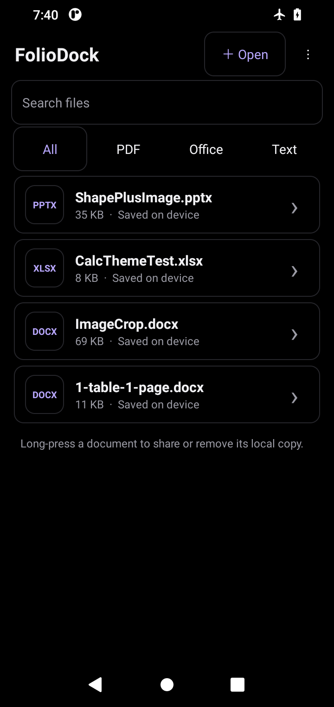
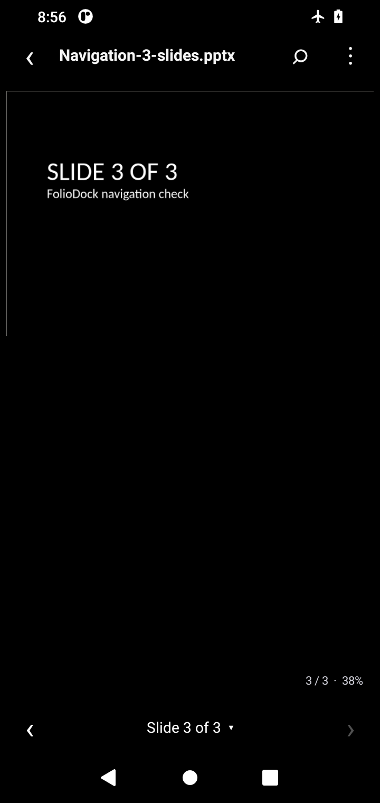

# FolioDock

An offline Android document reader with a monochrome AMOLED-black homepage, device-wide document discovery, a compact reader, and a real LibreOffice layout engine. Office pages are rendered with their layouts rather than reconstructed from extracted text.

 

Actual Android screenshots. The [QA record](docs/ANDROID_QA.md) documents update-data retention, storage discovery, and navigation through a three-slide presentation.

## Download the APK

Open [Releases](https://github.com/virgil48YT/foliodock/releases/latest) and download **FolioDock-arm64-v8a.apk** for a modern 64-bit ARM Android phone. **FolioDock-x86_64.apk** is for compatible Intel devices or Android emulators. The release assets are raw `.apk` files, not ZIP archives; `SHA256SUMS.txt` accompanies each build.

Android 8.0 or later is required. There is no 32-bit ARM build. Expect a substantially larger download than version 1 because the native layout engine and fonts are bundled for offline use.

**Normal updates install over the existing app. Do not uninstall a release-signed version first.** Download the newer APK and approve Android's update prompt. The package ID and persistent release signing key stay the same, while CI increases the internal Android version code on every build. Your private copies, preferences, and file index are retained.


The app and GitHub release are labeled **3.0**. Its internal version code is above 300000, higher than the earlier preview's 200005. This does not implement a background auto-updater; install the downloaded APK normally.

Only the earliest debug-signed prototype has a different signing key. Android cannot replace that signature with the release key in place. If you still have that prototype, back up app-only copies before the one-time migration. Subsequent release-signed updates do not require uninstalling.

## Reading experience

- **Monochrome AMOLED UI:** Pure `#000000` background, white/gray controls, cleaner document rows, and no purple branding. The launcher uses a larger adaptive document icon with no nested background tile, plus themed-icon support on Android 13+.
- **Specific file filters:** Horizontally scrollable PDF, DOCX, PPTX, XLSX, DOC, XLS, PPT, ODT/ODS/ODP, and text-format chips, plus Word, Excel, and PowerPoint family shortcuts. Search and “Show more” keep large libraries manageable.
- **Full Office layout:** LibreOffice 26.2.6.3 renders page geometry, paragraph styles, tables, images, drawings, and supported charts instead of flattening content into text.
- **Navigation:** Pinch to zoom, drag to pan, and double-tap to zoom in Office mode. Multi-slide presentations have visible previous/next arrows and a tappable slide counter in a compact 48 dp bottom strip. Other page/sheet, fit-width, and sharing actions remain in the overflow menu.
- **Page colors:** Original document colors are preserved by default. “Night page colors” optionally inverts the displayed PDF/Office bitmap without modifying the source file.
- **Text search:** TXT, Markdown, CSV, and TSV retain searchable text/table previews. Supported modern Office formats have an optional text preview for search; choosing Find from a layout preview switches to it. Return with “Full layout.”
- **Local files:** Android's system picker imports a bounded copy into app-private storage. Recent files, filtering, sharing, and deleting the local copy remain available.

## Storage access and device scanning

On first launch, FolioDock explains the optional storage request. Android 11+ opens the system **Allow access to manage all files** setting; Android 8–10 requests read-only external-storage permission. Granting access starts a scan. Declining does not block the app: **Open** still works through Android's document picker.

**Scan** walks accessible shared-storage folders and mounted volumes exposed by Android, including nested folders, and indexes supported Office, PDF, and text files. It does not upload files, open every document, duplicate every file, or modify originals. An individual document is copied into private preview storage only when you open it. **Stop** cancels a scan and retains the previous index. Use Scan again to refresh after files move or storage changes.

Other apps' protected `Android/data` and `Android/obb` folders are excluded, and inaccessible directories are reported rather than bypassed. Cloud-only providers and unmounted volumes require the picker or mounting first. All-files access is broad OS permission, but FolioDock's scanner and external-file opening paths only read originals. See [Android's all-files-access documentation](https://developer.android.com/training/data-storage/manage-all-files).

The index is limited to 50,000 supported documents per scan, with an explicit limit message rather than silently claiming a complete scan. File lists display 100 rows at a time with Show more. The existing 80 MB opening limit still applies; a larger document can appear in the index without being openable in this release. Library options can clear the index without deleting originals.

## Supported formats

| Family | Reader |
| --- | --- |
| PDF | Native Android `PdfRenderer`, original page layout, lazy page rendering |
| Word / Writer | DOC, DOCX, DOCM, DOT, DOTX, DOTM, ODT, OTT, FODT, RTF via LibreOffice |
| Excel / Calc | XLS, XLSX, XLSM, XLT, XLTX, XLTM, XLSB, ODS, OTS, FODS via LibreOffice |
| PowerPoint / Impress | PPT, PPTX, PPTM, PPS, PPSX, PPSM, POT, POTX, POTM, ODP, OTP, FODP via LibreOffice |
| Draw | ODG, OTG, FODG via LibreOffice |
| Text / data | TXT, MD, CSV, TSV through the bounded text/table reader |
| Other / damaged / encrypted | Error handling and external-app fallback; not a universal importer |

This is a full-layout engine, **not a guarantee of pixel-identical Microsoft Office output**. Font substitution, advanced charts, embedded objects, unusual formats, or unsupported features can differ. Macros and scripts are disabled; VBA is not executed. Encrypted files currently require another app. Office mode is read-only and does not implement editing, annotations, text selection, or saving changes. PDF search and pinch zoom are not implemented.

## Privacy and renderer safeguards

There is no Internet permission, analytics SDK, advertising SDK, cloud upload, or background synchronization. The only declared storage permissions are `MANAGE_EXTERNAL_STORAGE` and `READ_EXTERNAL_STORAGE` capped at Android 10 / API 29. File paths and the scan index remain app-private and are not sent to a conversion server. Native LibreOffice initialization, document handles, part changes, and tile painting are serialized on one process-lifetime worker. Rendering uses viewport tiles with a bounded bitmap cache, not a bitmap of an entire workbook. Native parser bugs can still crash the process; no document parser is a blanket guarantee that an arbitrary hostile file is safe.

The private LibreOffice profile explicitly disables macro execution and sets macro security to Very High before initialization. Display gestures do not send editing, macro, mouse, keyboard, or save commands to the document. Android backup/transfer exclusions cover the private document storage and engine profile.

Imports are limited to 80 MB. The fallback text parser retains bounded ZIP/XML expansion and output limits, UTF-8 XML restrictions, DTD/entity rejection, and spreadsheet pagination. Those text-parser limits are not represented as sandbox guarantees for the separate native engine.

## Build locally

Requirements: JDK 17, Android SDK platform 35, Build Tools 35.0.0, `curl`, `unzip`, and `sha256sum`. The Gradle 8.9 wrapper is included and verifies its distribution checksum.

```sh
export ANDROID_HOME=/path/to/android-sdk
./scripts/prepare-office-engine.sh
./gradlew testDebugUnitTest lintDebug assembleDebug
```

The preparation script downloads two original F-Droid LibreOffice APKs, verifies pinned SHA-256 hashes, and extracts only the required assets and native libraries into ignored dependency directories. It never copies the upstream application's DEX code. Build outputs contain separate ARM64 and x86_64 APKs.

For a signed release, provide your own signing credentials as environment variables:

```sh
export FOLIODOCK_STORE_FILE=/secure/path/release.jks
export FOLIODOCK_STORE_PASSWORD=...
export FOLIODOCK_KEY_PASSWORD=...
# Expected alias: foliodock
./gradlew testDebugUnitTest lintRelease assembleRelease
```

Never commit the keystore or passwords. The app's LibreOffice assets must remain uncompressed APK ZIP entries: its native virtual filesystem memory-maps stored assets. JNI libraries use legacy extraction packaging and are kept byte-identical to the pinned upstream binaries.

## GitHub CI and signing

Pushes to `main` and manual runs test, lint, build **non-debuggable, release-signed APKs**, verify the signatures, and publish raw APK assets to an immutable GitHub Release tied to the build commit. No Actions ZIP download is required. Pull requests run tests/lint and debug builds without release secrets.

The repository uses these GitHub Actions secrets:

```text
FOLIODOCK_KEYSTORE_BASE64
FOLIODOCK_STORE_PASSWORD
FOLIODOCK_KEY_PASSWORD
```

The key is decoded only into the runner's temporary directory and removed in an `always()` cleanup step. Do not print or expose these values. Losing or changing the signing key can prevent existing installations from accepting updates.

Release certificate SHA-256:

```text
46:A7:66:F3:06:54:E8:CF:E5:E3:A7:CE:D4:18:95:DE:4E:45:F6:2D:3D:64:DE:9E:9E:F0:DD:B4:B1:93:F4:5A
```


FolioDock's original code is MIT licensed. LibreOfficeKit bindings retain MPL-2.0 headers, and the unmodified native engine, fonts, and libraries retain their original licenses. Full component notices and corresponding-source links are in [THIRD_PARTY_NOTICES.md](THIRD_PARTY_NOTICES.md) and bundled under the app's `assets/licenses/` directory. FolioDock is not affiliated with LibreOffice, The Document Foundation, F-Droid, Google, or Microsoft.
